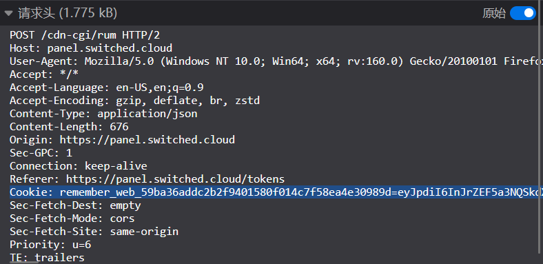

# switched.cloud 定时签到与任务控制台

轻量级纯 HTTP/GraphQL 服务端控制台，适用于 Linux / Debian（含 arm64），提供单总开关自动挂机、每日随机偏移定时触发、会话与 VPS 保活。

## 功能特性

- **单总开关守护模式**：打开总开关后自动检查并领取每日连签（Daily streak），按报价降序轮询已启用的免验证渠道；若未满额渠道均处于冷却期，保持总开关开启并自动休眠至最早冷却到期后继续；所有启用项目今日全部满额后自动关闭总开关。
- **每日定时触发**：支持按设定基准时间 ± 随机偏移（按日固定种子）自动打开总开关。
- **纯 HTTP 协议直刷**：
  - 自动支持：`adfocus`、`linkvertise`
  - 仅展示进度（需浏览器手动）：`cuty`、`vylo`、`cpx_research`
- **会话与 VPS 保活**：定时 `GET /tokens` 保活登录态并自动回写更新 Cookie；可选定时 `GET /vps/<uuid>` 防服务器闲置。
- **本地安全设计**：无密码鉴权，强制仅监听 `127.0.0.1:50914`。

## 目录结构

| 文件 | 说明 |
|---|---|
| `switched_core.py` | 面板快照解析、每日连签、会话/VPS 保活、`adfocus` 与 `linkvertise` 纯 HTTP/GraphQL 核心 |
| `web_app.py` | 本地 Web 控制台（`127.0.0.1:50914`）、单总开关调度器与保活后台线程 |
| `config.example.yaml` | 默认配置模板（首次启动自动复制为 `config.yaml`） |
| `requirements.txt` | Python 依赖清单 |
| `setup.sh` | 创建虚拟环境 `.venv` 并安装依赖 |
| `restart.sh` | 语法预检、防并发锁、安全停服与后台拉起脚本 |
| `assets/cookie_guide.png` | Cookie 复制示例图（同时内置展示于「Cookie与设置」页面底部） |
| `DEVELOPMENT.md` | 架构链路、非直观设计细节与踩坑记录（面向开发者与维护者） |

## 快速部署

```bash
# 1. 初始化虚拟环境与依赖
bash setup.sh

# 2. 启动（或安全重启）后台服务
bash restart.sh

# 3. 检查服务健康状态
curl -fsS http://127.0.0.1:50914/healthz
```

本机浏览器直接打开：`http://127.0.0.1:50914`

若部署在远程服务器，通过 SSH 端口转发访问（不直接暴露公网/局域网端口）：

```bash
ssh -L 50914:127.0.0.1:50914 <user>@<host>
```

## Cookie 配置说明

在控制台切换到 **「Cookie与设置」** 页面，按页面底部示例图操作即可：

> **复制一整行就可以了，不用筛选**

步骤：浏览器打开 `https://panel.switched.cloud/tokens` → 按 `F12` 打开开发者工具 → 切到「网络（Network）」→ 点击任意发往 `panel.switched.cloud` 的请求 → 打开请求头右上角 **「原始 / Raw」** → 复制整行 `Cookie: ...` 粘贴保存即可（建议包含 `remember_web_*` 以保持长期登录态）。



## 常用运维命令

```bash
# 前台调试启动
.venv/bin/python -B -u web_app.py

# 查看实时日志
tail -f web_app.log

# 语法预检
.venv/bin/python -B -c "import ast, pathlib; [ast.parse(pathlib.Path(f).read_text(encoding='utf-8')) for f in ('switched_core.py', 'web_app.py')]"
```

## 开发与架构文档

内部架构流、协议细节与踩坑记录见 [DEVELOPMENT.md](DEVELOPMENT.md)。
